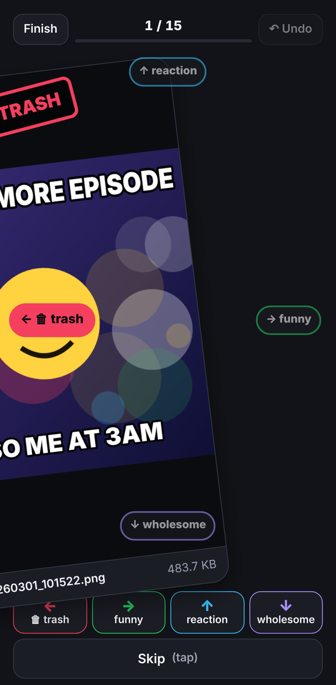
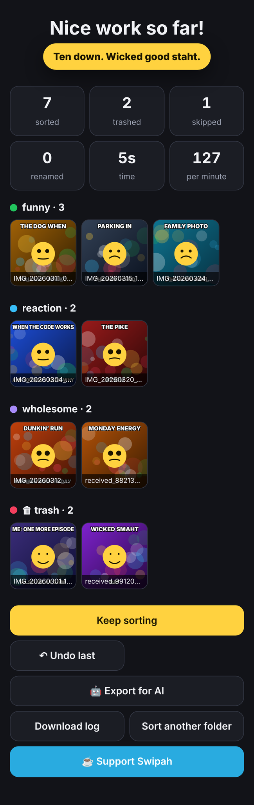
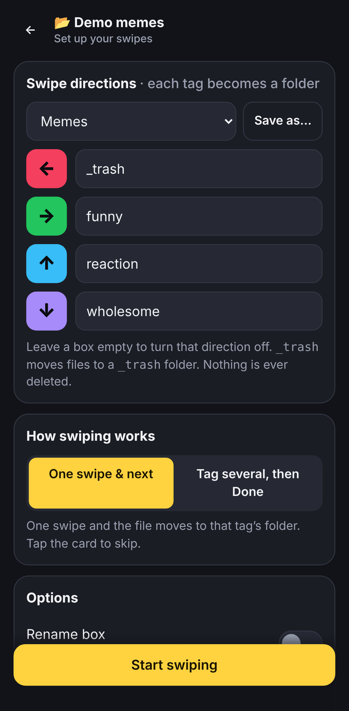

# Swipah

**Wicked fast sorting.**

Pick a folder. Swipe each photo, meme, video or song left, right, up or down to sort it into a tag. Get a recap reel at the end. **Your files never leave your device.**

<p>
  
  
  
</p>

**Try it:** https://yeomanscholar.github.io/swipah/ (once GitHub Pages is on). Hit **Try the demo** in any browser.

## What it does

- **Four directions, four tags.** Each tag is a folder inside the one you picked, and swiping moves the file there. `_trash` is just a folder. Nothing is ever deleted.
- **Two modes.** *One swipe & next* (fastest), or *Tag several, then Done*: toggle as many tags as you like, then double-tap, press Enter or hit Done. The file moves to the first tag and is copied into the rest.
- **Swipe, drag or type.** Touch swipe on phones, click-and-drag on desktop, or <kbd>←</kbd><kbd>→</kbd><kbd>↑</kbd><kbd>↓</kbd>, <kbd>Space</kbd> to skip, <kbd>Z</kbd> to undo.
- **Undo** anything, as far back as you like.
- **Rename as you go.** Turn on the rename box and type `not like us`. The file is saved as `not-like-us.jpg`. Names never overwrite (`not-like-us-1.jpg`), and names you've used before autocomplete.
- **Images, GIFs, videos and songs.** Audio plays automatically when its card comes up.
- **Resume** where you left off. On Android you'll re-pick the folder; Swipah remembers your progress.
- **Recap reel** at the end: everything you sorted, grouped by tag, with stats.
- **Milestone cheers.** At 50 swipes: *“My boy got mad organized.”*
- **AI-ready tag log.** Every decision is saved to `.swipah/log.jsonl` in your folder. **Export for AI** builds a bundle (numbered contact sheets, an index, the log and a ready-to-paste `PROMPT.md`) you can hand to Claude, Gemini or another AI so it learns how you tag and name things.

## Where it works

| | Sort real folders | Demo |
|---|---|---|
| Chrome / Edge on Windows, Mac, Linux, ChromeOS | ✅ | ✅ |
| Chrome on Android | ✅ (re-pick the folder each visit) | ✅ |
| Firefox, Safari, iPhone/iPad | ❌ (no folder access yet) | ✅ |

**Android tips**
- Pick a subfolder like `Pictures/Memes`. Android won't let apps open the very top of `Download` or your whole storage.
- Not sure your phone works? Open **Check my phone** (`test.html`). It runs every file operation Swipah needs on a folder you pick and reports ✅/❌, then cleans up after itself.
- **Google Photos:** Google doesn't let other apps reorganize your Google Photos library. Swipah sorts the files **on your phone** (the folders Google Photos backs up), not the cloud library.
- Install it: Chrome menu → **Add to Home screen**. It runs full-screen like an app and works offline.

## Privacy

Swipah is a static web page. There's no server, no account, no analytics and no cookies. Files are read and moved by your browser on your device. The tag log stays in your folder and your browser's storage. The AI export is files *you* choose to share.

## Run it locally

No build step, no dependencies.

```bash
npm start
```

Then open http://localhost:5173/. Any static server works (`python3 -m http.server`). The folder feature needs `localhost` or HTTPS, so opening `index.html` as a local file won't work.

## Tests

```bash
npm test
```

Runs unit tests for the sorting logic in Node, plus end-to-end tests in headless Chromium via Playwright: the demo flows, real-folder file operations against the browser's private storage, resume after reload, export, and the phone-check page. Needs Playwright with Chromium (`npm i -D playwright && npx playwright install chromium` if you don't have it).

## How it's built

Plain HTML/CSS/JavaScript modules. All file access goes through one storage adapter (`js/adapters/`), so a native Android or iOS version can swap it out later. See [`docs/SPEC.md`](docs/SPEC.md) for the full spec and roadmap.

```
index.html          the app
test.html           “Check my phone” capability test
js/main.js          screens + controller
js/session.js       queue, decisions, undo (all file ops)
js/adapters/        fs-access.js (real folders), memory.js (demo/tests)
js/gestures.js      swipe / drag / tap detection
js/log.js           tag log + fingerprints
js/export.js        Export for AI (contact sheets, index, prompt)
sw.js               offline support
```

## Roadmap

1. **Now:** web app (this repo).
2. **Next:** Android app on the Play Store (wrapping this web app), if people use it. iOS if people ask.
3. **Later:** AI features: suggested tags and filenames in *your* style, learned from your tag log.

## Support

Swipah is free. If it saved you time, [buy me a coffee ☕](https://ko-fi.com/).

MIT licensed.
